<div align="center">


# ✨ Aura Clicker ✨

**Jogo de ritmo + clicker em pixel art: acerte as notas no tempo da música e farme aura até a Aura Máxima!**

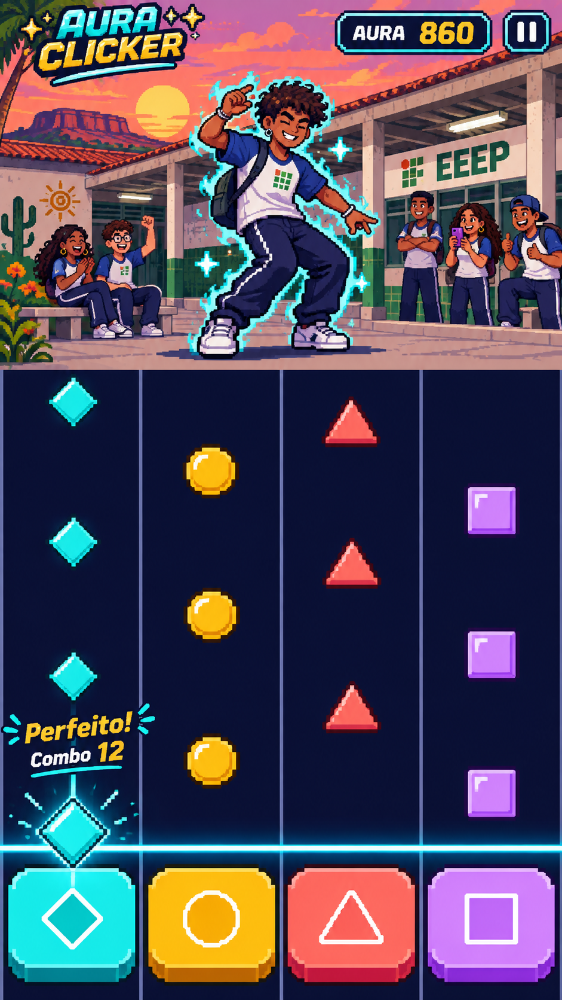

<br />


<br />

<a href="https://auraclicker.vercel.app/"></a>

<sub>🌐 <a href="https://auraclicker.vercel.app/">auraclicker.vercel.app</a> · roda no navegador do celular e do computador · <a href="https://auraclicker.vercel.app/?autoplay">ver o jogo se jogando sozinho</a></sub>

🏫 Feito na aula de **23/11/2026** da **EEEP de Quixadá** (CE),
curso de **ADS: Análise e Desenvolvimento de Sistemas**.

</div>

---

## 📖 Sumário

- [Sobre o jogo](#-sobre-o-jogo)
- [Capturas de tela](#-capturas-de-tela)
- [Como jogar](#-como-jogar)
- [Fases e desbloqueios](#-fases-e-desbloqueios)
- [Personalização](#-personalização)
- [Rodando o projeto](#-rodando-o-projeto)
- [Gerando o APK](#-gerando-o-apk)
- [Como funciona por dentro](#-como-funciona-por-dentro)
- [Estrutura do projeto](#-estrutura-do-projeto)
- [Limitações conhecidas](#-limitações-conhecidas)

---

## 🎮 Sobre o jogo

No **Aura Clicker** você é um aluno da EEEP que precisa ganhar **aura** na frente da galera. As notas descem por quatro pistas no ritmo de uma música chiptune. Cada acerto rende aura, aumenta o combo e deixa o personagem mais empolgado. Ele começa só batendo o pé, depois balança, dança e, ao chegar na **Aura Máxima**, levita enquanto os colegas comemoram.

A cada 16 acertos aparece o **Modo Aura**, a parte "clicker" do jogo: você tem quatro batidas para apertar o botão **FARME AURA!** o mais rápido que conseguir.

- 🎵 4 músicas chiptune originais, **geradas pelo próprio código**, sem nenhum arquivo de áudio
- 🗺️ 4 cenários em pixel art: pátio da EEEP, laboratório, festival e palco
- 🧑‍🎨 Personagem customizável: roupa, cor, acessório, aura, pele e cabelo
- 📱 Funciona no celular (em pé, com toque em várias pistas ao mesmo tempo) e no computador (teclado)
- 💾 Progresso e visual salvos automaticamente

---

## 📸 Capturas de tela

### Menu

<table>
  <tr>
    <td align="center">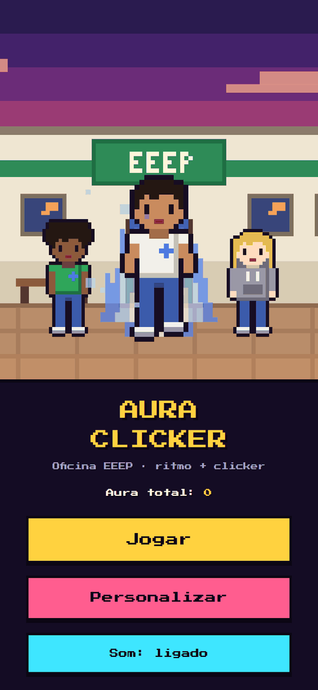<br /><sub>Celular</sub></td>
    <td align="center">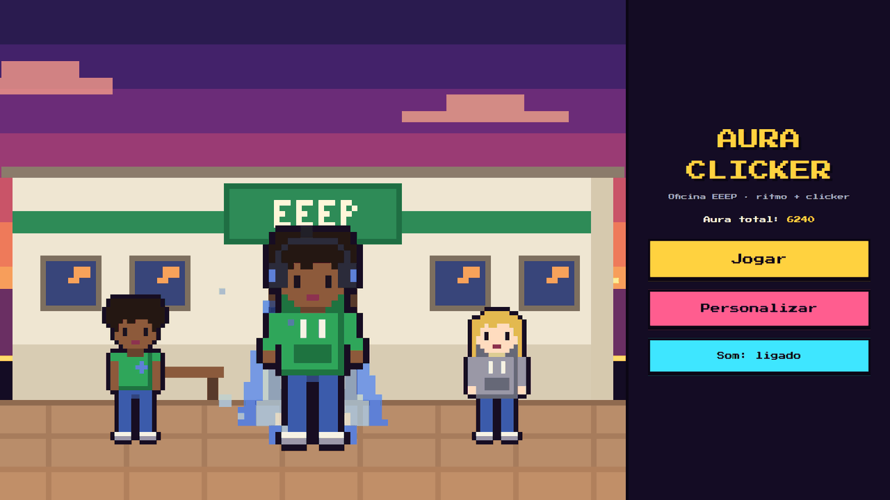<br /><sub>Computador</sub></td>
  </tr>
</table>

### Jogando

<p align="center">
  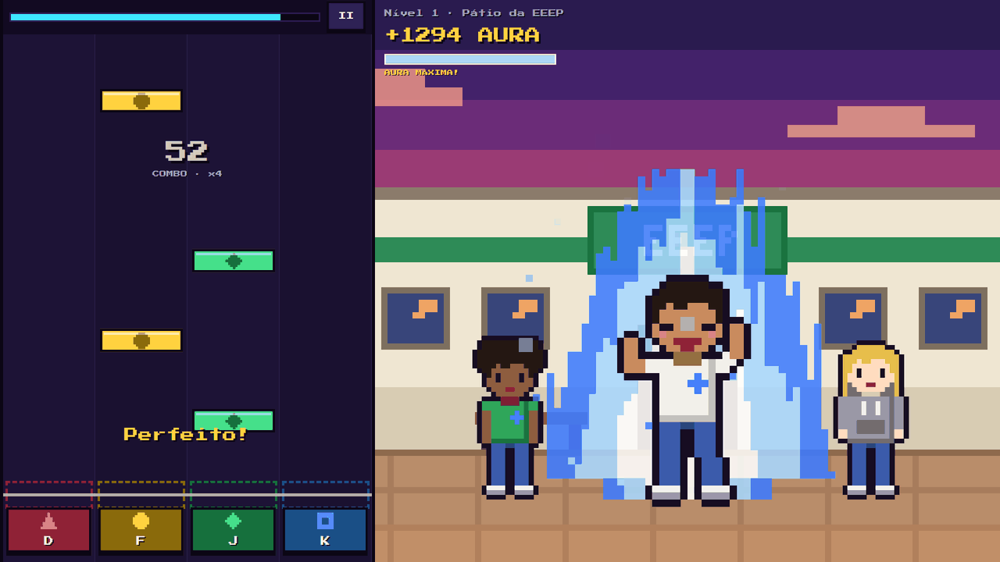
  <br /><sub>Pátio da EEEP: combo de 52 (multiplicador x4) e o personagem em Aura Máxima</sub>
</p>

<table>
  <tr>
    <td align="center">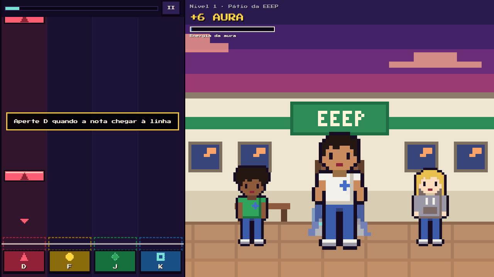<br /><sub>Tutorial do Nível 1: começa só com a tecla D</sub></td>
    <td align="center">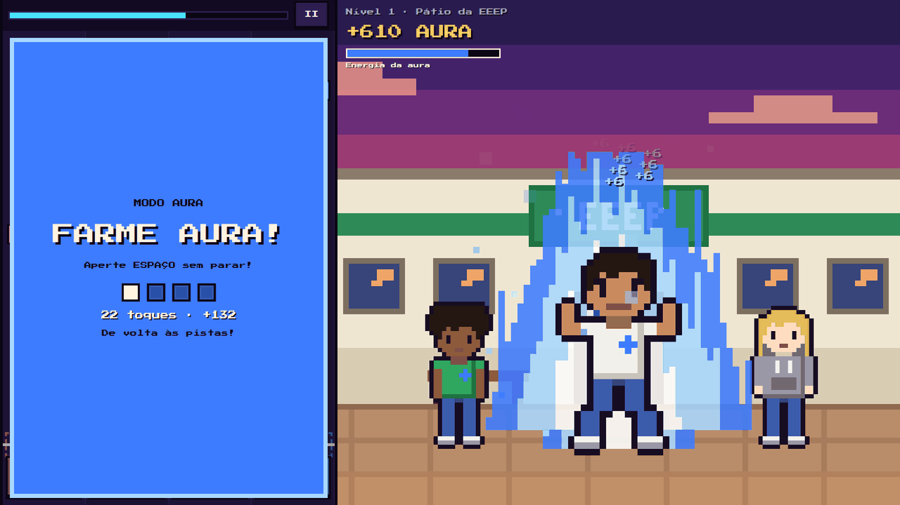<br /><sub>Modo Aura: "FARME AURA!"</sub></td>
  </tr>
</table>

<table>
  <tr>
    <td align="center">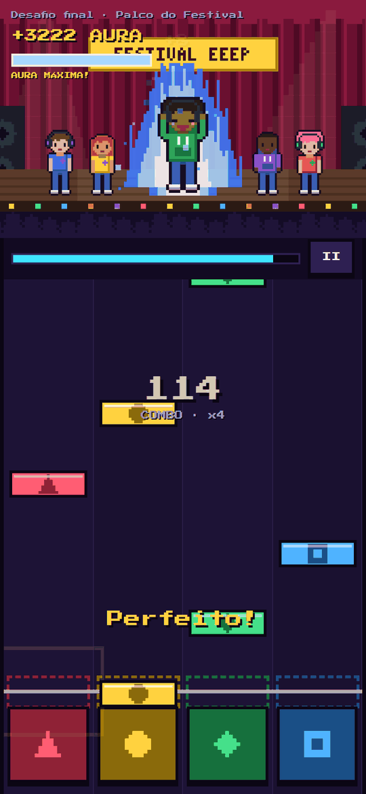<br /><sub>Palco do Festival no celular</sub></td>
    <td align="center">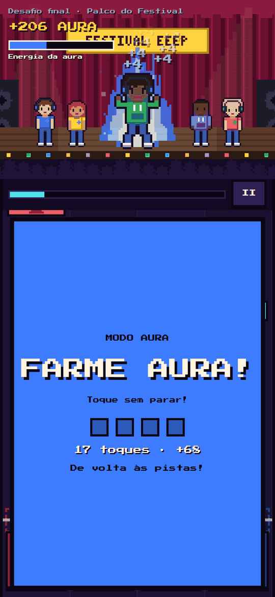<br /><sub>Modo Aura no celular</sub></td>
    <td align="center">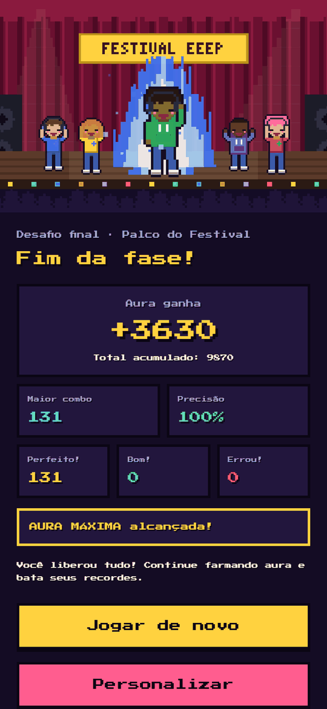<br /><sub>Resultado do Desafio final</sub></td>
  </tr>
</table>

### Fases, personalização e resultado

<p align="center">
  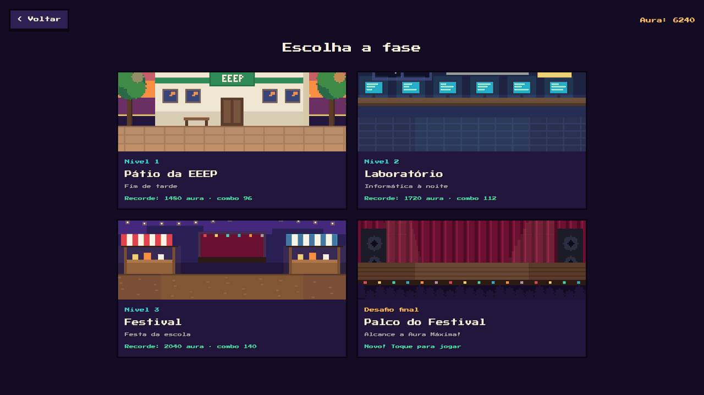
  <br /><sub>Os quatro cenários, com recorde de aura e combo</sub>
</p>

<p align="center">
  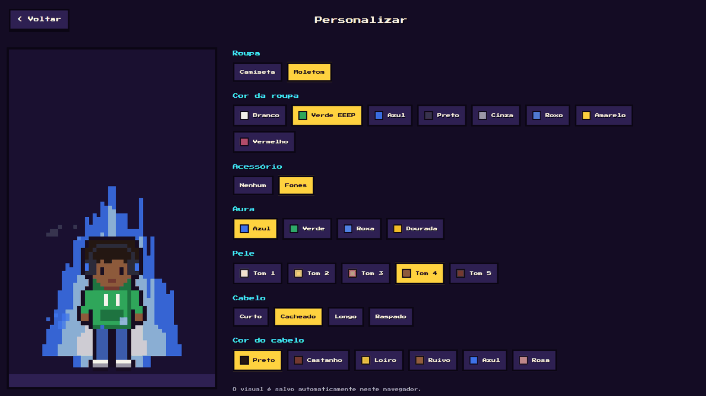
  <br /><sub>Personalização com prévia ao vivo</sub>
</p>

<p align="center">
  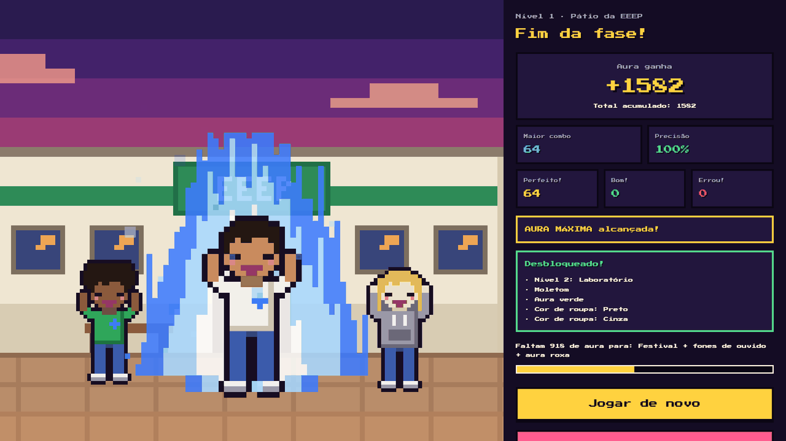
  <br /><sub>Fim da fase: aura ganha, precisão, itens desbloqueados e quanto falta para a próxima recompensa</sub>
</p>

---

## 🕹️ Como jogar

Aperte a tecla (ou toque no botão) da pista **no momento em que a nota chega na linha**.

| Pista | Tecla | Símbolo | Cor |
| :---: | :---: | :---: | :---: |
| 1 | <kbd>D</kbd> | ▲ triângulo | 🟥 vermelho |
| 2 | <kbd>F</kbd> | ● círculo | 🟨 amarelo |
| 3 | <kbd>J</kbd> | ◆ losango | 🟩 verde |
| 4 | <kbd>K</kbd> | ■ quadrado | 🟦 azul |
| Modo Aura | <kbd>Espaço</kbd> | botão **FARME AURA!** | — |

No celular é só tocar nas pistas. Cada dedo é lido separadamente, então dá para apertar duas pistas ao mesmo tempo.

### Pontuação

| Acerto | Janela de tempo | Aura |
| --- | --- | --- |
| **Perfeito!** | até 50 ms da batida | 6 × multiplicador |
| **Bom!** | até 110 ms da batida | 3 × multiplicador |
| **Errou!** | fora da janela | 0 (zera o combo, mas **não tira** aura) |
| Toque no Modo Aura | durante as 4 batidas | 2 × multiplicador por toque |

| Combo | Multiplicador |
| --- | --- |
| 0 a 9 | x1 |
| 10 a 24 | x2 |
| 25 a 49 | x3 |
| 50 ou mais | **x4** |

A barra de **energia da aura** enche a cada acerto. Quando chega em 100%, o personagem alcança a **Aura Máxima**: ele levita e os colegas comemoram.

> 💡 **Dica para apresentar:** abra **[auraclicker.vercel.app/?autoplay](https://auraclicker.vercel.app/?autoplay)** e o jogo se joga sozinho, ótimo para mostrar na aula.

---

## 🗺️ Fases e desbloqueios

A aura ganha em cada partida se acumula. Quanto mais aura total, mais coisas são liberadas:

| Fase | Cenário | Música | Libera com | Recompensas |
| --- | --- | --- | ---: | --- |
| **Nível 1** | Pátio da EEEP, fim de tarde | 96 BPM | 0 | camiseta, aura azul, cores branco/verde EEEP/azul |
| **Nível 2** | Laboratório de informática à noite | 112 BPM | 800 | moletom, aura verde, cores preto/cinza |
| **Nível 3** | Festival da escola | 124 BPM | 2.500 | fones de ouvido, aura roxa, cores roxo/amarelo |
| **Desafio final** | Palco do Festival | 136 BPM | 5.000 | cor vermelha |
| 🏆 **Segredo** | — | — | Aura Máxima no Desafio final | **aura dourada** |

O Nível 1 tem um **tutorial** que apresenta uma pista por vez: primeiro só o D, depois o F, depois J e K, e por fim tudo misturado.

---

## 🎨 Personalização

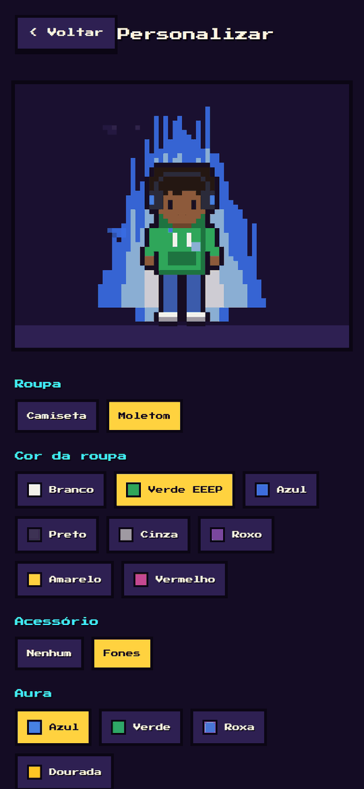

Tudo aparece na hora na prévia do personagem:

- **Roupa:** camiseta ou moletom
- **Cor da roupa:** branco, verde EEEP, azul, preto, cinza, roxo, amarelo, vermelho
- **Acessório:** nenhum ou fones de ouvido
- **Aura:** azul, verde, roxa ou dourada
- **Pele:** 5 tons
- **Cabelo:** curto, cacheado, longo ou raspado, em 6 cores

O visual fica salvo junto com o progresso.

<br clear="right" />

---

## 🚀 Rodando o projeto

> 🌐 Só quer jogar? Abra **[auraclicker.vercel.app](https://auraclicker.vercel.app/)**. O site é publicado na Vercel a cada push no `master`, usando a configuração do [vercel.json](vercel.json).

**Pré-requisitos:** [Node.js](https://nodejs.org/) em uma versão LTS recente.

```bash
# 1. Instalar as dependências
npm install

# 2. Rodar no navegador
npm run web
```

Outros comandos úteis:

```bash
npx expo start                       # servidor de desenvolvimento (abre no Expo Go pelo QR code)
npx expo export --platform web       # gera a pasta dist/ para hospedar o jogo em qualquer site estático
npx tsc --noEmit                     # checa os tipos do TypeScript
```

---

## 📦 Gerando o APK

O APK é gerado na nuvem pelo **EAS Build** da Expo, sem precisar do Android Studio. O perfil `preview` do [eas.json](eas.json) produz um `.apk` que pode ser instalado direto no celular.

```bash
npx eas-cli@latest login
npx eas-cli@latest build -p android --profile preview
```

No fim, o EAS mostra um link e um QR code para baixar o APK. No Android, é preciso permitir a instalação de "fontes desconhecidas" para instalar o arquivo.

---

## 🧠 Como funciona por dentro

- **Um relógio só.** Música, posição das notas e julgamento dos acertos usam o mesmo relógio, o `AudioContext.currentTime` do Web Audio, já descontando o atraso da saída de som. Por isso a nota que você vê na linha é exatamente a batida que você ouve.
- **Música gerada por código.** Cada música é descrita como seções (bateria, baixo, melodia, arpejo) em [src/game/songs.ts](src/game/songs.ts) e tocada por sintetizadores em [src/audio/engine.ts](src/audio/engine.ts). As notas do jogo saem da **mesma estrutura** da música, então sempre caem na batida e seguem a melodia.
- **Pixel art em código.** Personagens, cenários e ícones são desenhados como retângulos ([src/pixel/](src/pixel/)) e renderizados com `react-native-svg`. Por isso trocar a cor da roupa ou do cabelo é só trocar a paleta.
- **Uma base para web e celular.** O mesmo código em React Native roda no navegador (via `react-native-web`) e no Android. O layout se adapta: deitado no computador, em pé no celular.
- **Save local.** O progresso fica no `AsyncStorage` (o `localStorage` no navegador).

---

## 🗂️ Estrutura do projeto

```text
auraclicker/
├── App.tsx                 # navegação entre as telas e regras de progresso
├── app.json                # configuração do app Expo (nome, ícones, pacote Android)
├── eas.json                # perfis de build do EAS (APK no perfil "preview")
├── assets/                 # ícone, logo e ícones adaptativos do Android
├── docs/screenshots/       # imagens deste README
└── src/
    ├── audio/engine.ts     # sintetizador chiptune + relógio do jogo
    ├── game/songs.ts       # as 4 músicas e a geração das notas
    ├── data/items.ts       # fases, roupas, cores, auras e recompensas
    ├── save.ts             # salvar/carregar progresso
    ├── theme.ts            # paleta de cores
    ├── pixel/              # pixel art: personagem, cenários, ícones
    ├── components/         # Hero, Stage e componentes de interface
    └── screens/            # Menu, LevelSelect, Game, Customize, Results
```

---

## ⚠️ Limitações conhecidas

- **No APK o jogo roda sem som.** O sintetizador usa a Web Audio API, que só existe no navegador. No Android o jogo funciona com um relógio interno, mas sem música. Para ter som no app, dá para adicionar a biblioteca `react-native-audio-api` e gerar um novo APK.
- A navegação usa estados simples no `App.tsx` em vez do Expo Router: para um jogo com cinco telas e sem endereços próprios, isso fica mais simples.

---

<div align="center">

Feito com 💙 na **EEEP de Quixadá**, turma de **Análise e Desenvolvimento de Sistemas**, 23/11/2026.


</div>
